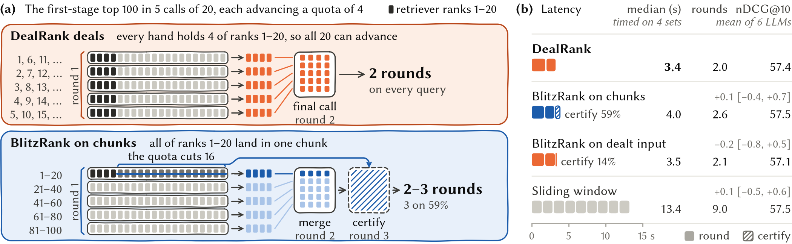

<div align="center">
  <a href="https://www.mixedbread.com">
    <picture>
      <source media="(prefers-color-scheme: dark)" srcset="docs/images/mixedbread_wordmark_dark.png">
      
    </picture>
  </a>

  <h1>DealRank</h1>

  <p><b>Deal With It: On Better Schedules for Listwise Reranking</b></p>

  <p>
    📄 <a href="https://arxiv.org/abs/2611.22392"><b>Preprint</b></a> &nbsp;·&nbsp;
    📝 <a href="https://www.mixedbread.com/blog/dealrank"><b>Blog post</b></a> &nbsp;·&nbsp;
    🍞 <a href="https://www.mixedbread.com"><b>Mixedbread</b></a>
  </p>
</div>

Parallel listwise reranking with LLMs: deal the candidates into hands like cards, keep a quota
from each hand, and rank the finalists in one call.



*Dealing gives each of five calls four of BM25's top twenty, so a quota of four cuts none of them.*

## Why dealing

A listwise LLM reranker reads a query and about twenty passages and returns their order, so
reranking a hundred or more candidates takes a *schedule* of calls. Parallel schedules split the
candidates into groups, rank every group at once and advance a fixed quota from each. Retrievers
put relevant passages near the top, so contiguous chunks (ranks 1 to 20, 21 to 40, ...) crowd them
into the first group, whose quota then cuts good passages.

Dealing the list round-robin by retriever rank, so that hand *i* gets ranks *i*, *i*+5, *i*+10, ...,
gives every hand the same share of the top. DealRank deals five hands of twenty, ranks them in
parallel and ranks their twenty finalists in one call: six calls in two rounds for 100 candidates.
Averaged over six LLMs on ten TREC and BEIR benchmarks, it is within 0.1 nDCG@10 points of
BlitzRank and the sliding window, and over the Gemini 3 Flash API its median latency is 3.4
seconds, against 4.0 for BlitzRank (first calls concurrent) and 13.4 for the sliding window.

## Installation

`dealrank` needs Python 3.10 or later. Install it from the root of this repository:

```bash
pip install .               # core: no dependencies beyond the standard library
pip install ".[openai]"     # OpenAI-compatible endpoints: OpenAI, OpenRouter, vLLM, ...
pip install ".[litellm]"    # any provider supported by LiteLLM
pip install ".[all]"        # every optional dependency, including vLLM and the experiment tools
```

Other extras: `jointrank`, `vllm`, `experiments` and `dev`.

## Quick start

```python
from dealrank import DealRank
from dealrank.llm import OpenAICompatible

llm = OpenAICompatible.openrouter("google/gemini-3-flash-preview")  # key from OPENROUTER_API_KEY
reranker = DealRank(llm, window=20, quota=4)

passages = [...]  # the retriever's top 100 texts, best first
result = reranker.rerank("what causes the northern lights", passages)
top10 = result.reorder(passages)[:10]
print(result.num_calls, result.num_rounds, round(result.critical_path_s(), 2))  # 6 2 ...
```

This example needs the `openai` extra and an OpenRouter key. To try the package without either,
replace `llm` with `dealrank.FakeLLM()`, an offline stand-in that returns each call's passages in
the order given.

`result.ranking` holds positions into `passages`, best first, and `result.rounds` holds every
call, grouped by round, with its tokens and latency. In async code, use
`await reranker.arerank(query, passages)`. The calls of one round run concurrently, up to the
LLM's `max_concurrency`.

## What is in the package

| Schedule | Calls | Rounds | Notes |
|---|---:|---:|---|
| `DealRank(window=20, quota=4)` | 6.0 | 2.0 | five dealt hands, then one final call |
| `BlitzRank(input_order="retriever")` | 6.6 | 6.6 | BlitzRank as released, on contiguous chunks |
| `BlitzRank(concurrent_cover=True)` | 6.1 | 2.1 | dealt input (the default), first calls run at once |
| `SlidingWindow(window=20, stride=10)` | 9.0 | 9.0 | RankGPT |
| `TourRank(tournaments=1)` | 13.0 | 5.0 | permutation prompt instead of select-top-m |
| `TDPart()` | 6.9 | 2.9 | top-down partitioning, with the original's promotion budget (20) |
| `JointRank(replicates=4)` | 20.0 | 1.0 | needs the `jointrank` extra |
| `ListK()` | – | – | ListK's multi-pivot quickselect, with pivots chosen by retriever rank in place of its embedding-based choice (Figure 3 only) |
| `HierarchicalDealRank(first_quota=2)` | 56 | 3 | 1,000 candidates; `first_quota=3` for 500 |

Calls and rounds are the paper's measured means per query with 100 BM25 candidates (Gemini 3
Flash, Table 1; BlitzRank's were measured with its authors' package), except the last row, which
gives exact counts for 1,000 candidates. `BlitzRank()` in this package defaults to dealt input;
BlitzRank as released is `input_order="retriever"`.

Every schedule in this package shares one prompt (RankGPT's permutation prompt, passages cut to
300 words), one parser and one LLM interface. The paper's BlitzRank numbers with Gemini 3 Flash
were instead obtained with BlitzRank's released package, which builds its own prompt and parses
its own answers (see [`experiments/README.md`](experiments/README.md)). The baselines are
reimplementations under the shared prompt, and that file lists their settings and where they
depart from the originals. To measure the effect of the split on its own, `DealRank` takes a
`split` argument (`"deal"`, `"chunks"` or `"random"`), and the other schedules take a
counterpart: `input_order` for `BlitzRank`, `split` for `TourRank`, `tail_split` for `TDPart`,
`bucket_split` for `ListK` and `design` for `JointRank`.

The split itself is a plain function:

```python
>>> from dealrank import deal, chunks
>>> deal(10, 3)
[[0, 3, 6, 9], [1, 4, 7], [2, 5, 8]]
>>> chunks(10, 3)
[[0, 1, 2, 3], [4, 5, 6, 7], [8, 9]]
```

### Deeper pools

`DealRank` advances `quota` passages from each of `ceil(n / window)` hands into a single final
call, which suits up to about a hundred candidates. For 500 or 1,000 candidates,
`HierarchicalDealRank` adds one more dealt round so that every elimination is made by an LLM call:

```python
from dealrank import HierarchicalDealRank

# 1,000 candidates: 50 hands keep 2, then 5 hands keep 4, then one final call.
reranker = HierarchicalDealRank(llm, window=20, first_quota=2)
result = reranker.rerank(query, passages)
```

### Other LLMs

Any OpenAI-compatible server works, including a local vLLM server:

```python
from dealrank.llm import OpenAICompatible, LiteLLM

llm = OpenAICompatible("gpt-5.5")  # OpenAI
llm = OpenAICompatible.vllm("Qwen/Qwen3.8-27B", base_url="http://127.0.0.1:8000/v1")
llm = LiteLLM("openrouter/google/gemini-3-flash-preview")  # any LiteLLM provider
```

`OpenAICompatible.openrouter` disables reasoning and `OpenAICompatible.vllm` disables thinking in
the chat template, as in our experiments. All backends default to temperature 0, seed 42 and at most
1,024 output tokens. To use your own client, subclass `dealrank.llm.ListwiseLLM` and implement one
async method, `complete(messages)`, which returns a `dealrank.llm.Completion`.

`dealrank serve-vllm MODEL` starts a vLLM server with the paper's local settings (bf16, tensor
parallelism 2, prefix caching off). It needs vLLM installed, and `--dry-run` prints the command
without running it.

### Command line

```bash
dealrank rerank queries.jsonl --openrouter --model google/gemini-3-flash-preview -o reranked.jsonl
dealrank rerank queries.jsonl --vllm --model Qwen/Qwen3.8-27B --schedule blitzrank --concurrent-cover
dealrank rerank queries.jsonl --fake    # offline check: no model, the input order is kept
dealrank deal 100 --window 20           # print the five hands
```

Each input line holds `query` and either `candidates` (a list of `{"docid", "text"}`) or
`passages` (a list of strings), in retriever order. Each output line holds the reranked docids
(positions, when the input gave `passages`), the number of calls, rounds and tokens, and the
critical path in seconds.

## Reproducing the paper

The configurations, commands, costs and hardware behind the paper's tables, figures and claims are
in [`experiments/README.md`](experiments/README.md). The per-query run records of the paper are not
in this repository: reproducing a table means running its configurations again (about USD 3,100 of
API calls and 100 hours on two H100s for everything). Without any of that, the repository lets you
recompute Proposition 1's numbers, run the tests and dry runs offline, and redraw the three figures
from the aggregate values shipped with the figure scripts. That file also lists the conventions behind
each number.

## Tests

```bash
pip install -e ".[dev]"
pytest    # offline, with dealrank.FakeLLM
```

A few tests are skipped when optional packages are missing (`openai`, `blitzrank`, `matplotlib`,
`ir-measures`); `pip install -e ".[experiments]"` installs all but `blitzrank`.

## Citation

```bibtex
@misc{clavie2026dealwithit,
  title         = {Deal With It: On Better Schedules for Listwise Reranking},
  author        = {Clavi{\'e}, Benjamin and Shandilya, Herumb and Lichtenberg, Hanna and Shakir, Aamir and Kato, Makoto P.},
  year          = {2026},
  eprint        = {2611.22392},
  archivePrefix = {arXiv},
  primaryClass  = {cs.IR},
  url           = {https://arxiv.org/abs/2611.22392}
}
```

## License

Apache-2.0. See [LICENSE](LICENSE).
